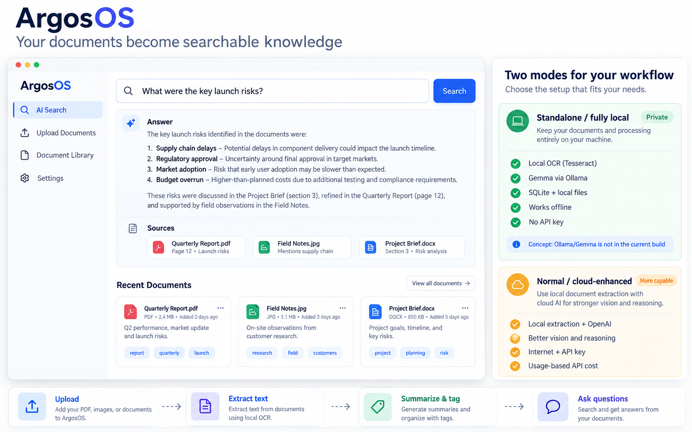
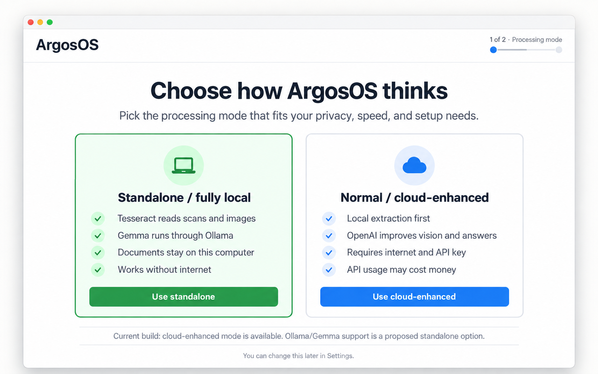

# How ArgosOS works

ArgosOS turns PDFs, Word documents, text files, and images into a local,
searchable document library.

The basic flow is the same in either processing mode:

1. Upload a document.
2. Extract its text. ArgosOS reads text directly from PDFs, DOCX, TXT, and
   Markdown files. Scans and images use OCR.
3. Generate a summary and tags.
4. Search the library and ask questions about the stored documents.

Raw files, extracted content, document metadata, summaries, and tags are stored
locally in SQLite and the ArgosOS data directory.

## What “standalone” means

There are two related ideas that should not be confused:

- **Standalone application packaging is available today.** The packaged
  Electron application starts its bundled Python backend and stores its data in
  the operating system's application-data directory. It does not require a
  separately hosted ArgosOS server.
- **A fully local AI processing mode is a proposed option.** In the mockups,
  this mode combines Tesseract OCR with a Gemma model served by Ollama so that
  summaries, tags, and answers can be generated without an API key or internet
  connection. Ollama/Gemma support is not implemented in the current codebase.

## Processing modes

| | Standalone / fully local (proposed) | Normal / cloud-enhanced (current) |
|---|---|---|
| Text and OCR | Local extraction and Tesseract | Local extraction, with OpenAI Vision available for images |
| Summaries, tags, answers | Gemma through Ollama | OpenAI API |
| Internet | Not required after model installation | Required for AI features |
| API key | Not required | Required for AI features |
| Data location | Local files and SQLite | Files and database remain local; selected content is sent to OpenAI for AI processing |
| Tradeoff | Maximum privacy and offline use; requires a local model download and enough RAM/CPU or GPU | Easier setup and stronger hosted vision/reasoning; can incur API usage charges |

Without an OpenAI API key, the current build can still store documents, extract
text locally, and perform basic search. AI-generated summaries, tags, and direct
answers are skipped or reduced.

## Suggested user-facing wording

Use **Packaged desktop app** when describing the installable Electron build.
Use **Fully local AI** for the proposed Tesseract + Ollama/Gemma processing
mode. Use **Cloud-enhanced AI** for the current OpenAI-backed processing path.
This avoids using “standalone” for both packaging and AI execution.
