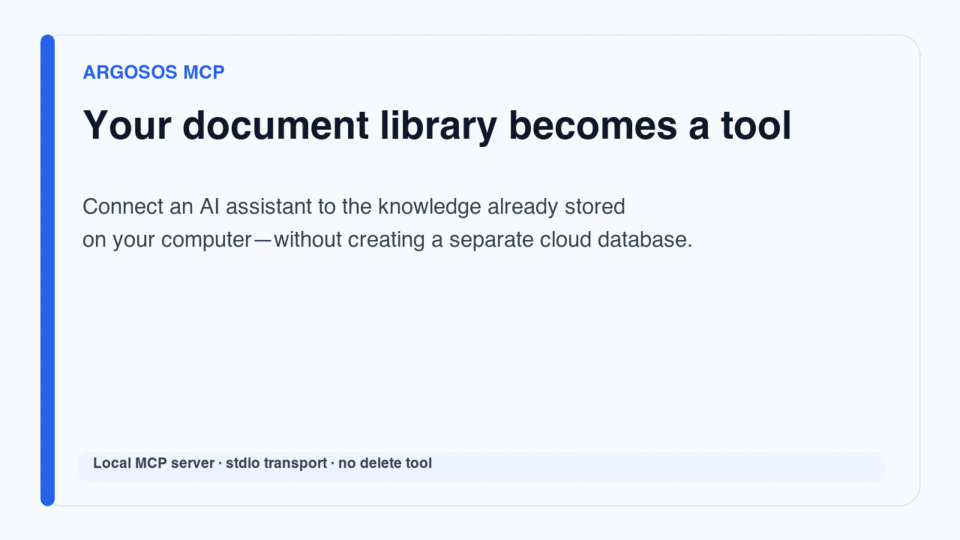
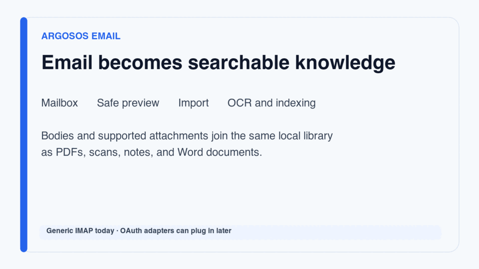

# ArgosOS demos

These short demos use synthetic names and example content. They do not contain
mailbox data, API keys, environment variables, or other user information.

## MCP tools



[Download or play the MP4 demo](media/argos-mcp-tools.mp4)

The local MCP server lets a compatible AI host:

1. list documents and tags;
2. search titles, summaries, and tags; and
3. read extracted text for a selected document.

The interface deliberately omits delete operations and arbitrary filesystem
access. MCP, FastAPI, and future scheduled automations share the service in
`app/tools/service.py`, so they receive the same validation and deduplication.

## Email ingestion



[Download or play the MP4 demo](media/argos-email-ingestion.mp4)

Email ingestion follows a reviewable sequence:

1. `argos_email_status` confirms non-secret connection settings.
2. `argos_email_preview` fetches message metadata using IMAP `BODY.PEEK`.
3. `argos_email_sync` imports selected bodies and supported attachments.
4. Existing extraction, OCR, and content hashes process the imported material.

Messages remain unread by default. The caller must explicitly request
`mark_seen=true` to change that state. ArgosOS does not currently expose tools
for sending, deleting, or moving email.

## Rebuild the demos

The source frames and rendering script are included so the videos can evolve
with the product:

```bash
./scripts/build_demo_videos.sh
```

The script requires ImageMagick and FFmpeg. It renders 1280×720 H.264 MP4 files
and smaller animated GIF previews suitable for GitHub documentation.
